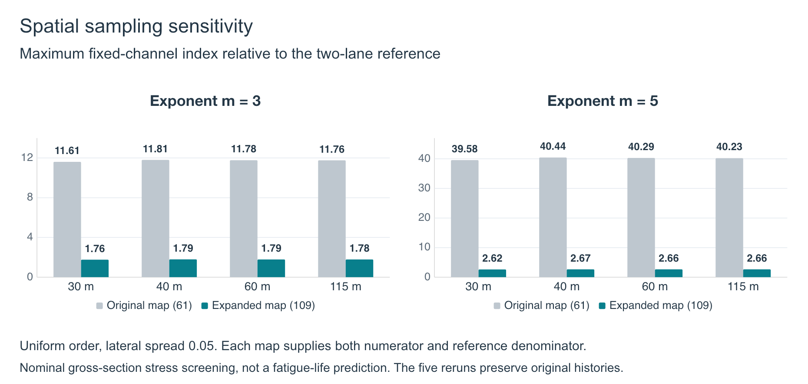
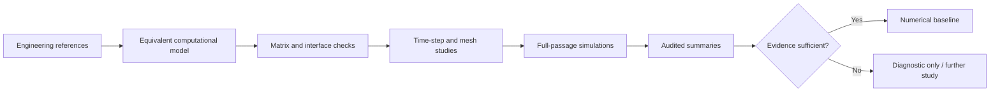

# Traffic Organization and Bridge Deck Response

**Wang Yanjun**  
Civil, Environmental and Resources Engineering, Faculty of Engineering, Kyoto University

A research case study in vehicle–bridge interaction, spatial sampling and numerical verification. Preliminary results, October 2026.

[Read the research poster](poster/VBI_research_poster.pdf) · [Editable PowerPoint](poster/VBI_research_poster.pptx) · [Results and interpretation](docs/results.md) · [My contribution](CONTRIBUTION.md)

## Selected finding

Expanding the recording map from **61 to 109 interior locations** changed the relative nominal stress-cycle index, even though all original moment histories remained exactly unchanged. For four selected uniform-order traffic cases, the maximum fixed-channel I₃ ratio to the two-lane reference changed from **11.61–11.81** to **1.76–1.79**. The reference case benefited much more from the added locations.

This finding demonstrates the importance of checking spatial sampling before interpreting relative cycle demand. These ratios describe a particular gross-section nominal-stress screening study. They are not fatigue-life ratios or established whole-deck maxima. [Read the definitions and scope](docs/results.md).

## Overview

Vehicle–bridge interaction (VBI) simulations combine bridge dynamics, moving vehicles, road-surface geometry, contact mapping, and time integration. A simulation can finish successfully while still producing results that are numerically fragile or physically over-interpreted.

This case study presents the work I completed: turning a complex research workflow into an auditable sequence of model reconstruction, numerical checks, convergence studies, and carefully scoped conclusions.

The original bridge drawings and reference materials were provided by Professor Zhang. They are intentionally not included because I do not own the right to redistribute them. The private source framework and research files are also excluded. The reconstruction, implementation, verification workflow, simulation review, and documentation described here are my own work.

## My contribution

My work focused on three connected areas:

1. **Model reconstruction and traceability**
   - Organized bridge geometry, mass, stiffness, support, and vehicle-contact assumptions into a consistent computational model.
   - Kept equivalent modeling assumptions separate from quantities directly supported by engineering references.
   - Added traceable checks for mass, stiffness, geometry, and model interfaces.

2. **Numerical verification**
   - Designed time-step and mesh-sensitivity studies instead of relying on a single successful run.
   - Checked matrix symmetry, positive definiteness, equilibrium, eigen-equation residuals, contact-force partition, virtual work, and solver convergence.
   - Distinguished global-response checks from local bridge-end acceleration and fatigue-related quantities.

3. **Reproducible execution and review**
   - Structured long-running simulations around explicit inputs, status records, provenance, and bounded output storage.
   - Separated diagnostic runs, numerically accepted baselines, and results that were not yet physically validated.
   - Documented failure conditions and unresolved limitations so that incomplete evidence could not be mistaken for final validation.

## Research workflow

The key principle was that **completion is not validation**. Each conclusion was tied to the scope of the evidence that supported it.

## Technical highlights

- MATLAB-based finite-element and time-integration workflow.
- Coupled vehicle–bridge contact with finite contact-patch assumptions.
- Large bridge models with tens of thousands of dynamic degrees of freedom.
- Modal, static, transient, and interface-level numerical checks.
- Mesh and time-step sensitivity studies for peak displacement and acceleration.
- Long-duration traffic simulations with convergence and provenance records.
- Explicit separation between numerical verification, reference calibration, and physical validation.

## What I learned

- A low solver residual does not prove that the physical model is correct.
- Local acceleration peaks can be much more sensitive than global displacement.
- Model calibration must be disclosed; matching selected frequencies is not independent validation.
- Recording every state at every time step is often unnecessary and can make a study operationally impractical.
- Reproducibility depends as much on provenance and scope control as on the numerical algorithm itself.

## Repository map

- [`poster/`](poster/) — one-page research poster in PDF and editable PowerPoint.
- [`docs/results.md`](docs/results.md) — selected results, exact definitions and numerical tables.
- [`docs/poster-abstract.md`](docs/poster-abstract.md) — abstract and suggested citation.
- [`docs/methodology.md`](docs/methodology.md) — modeling and verification strategy.
- [`docs/validation.md`](docs/validation.md) — evidence hierarchy and acceptance logic.
- [`docs/disclosure.md`](docs/disclosure.md) — what is intentionally excluded and why.
- [`CONTRIBUTION.md`](CONTRIBUTION.md) — concise authorship and collaboration statement.

## Scope and limitations

This repository does **not** claim:

- ownership of the original VBI framework;
- release of the collaborative project's implementation;
- experimental validation of the bridge model;
- prediction of real-bridge safety or absolute fatigue life;
- permission to reproduce any source engineering document.

It is a portfolio case study about research reasoning, numerical verification, and responsible technical communication.

## Acknowledgement

I thank Professor Zhang for providing the bridge drawings and source reference materials used in the research. Those materials remain the property of their respective owners and are not reproduced here.

## Contact

For admissions or research-related questions, please contact me through [my GitHub profile](https://github.com/AkaiSora1337).

