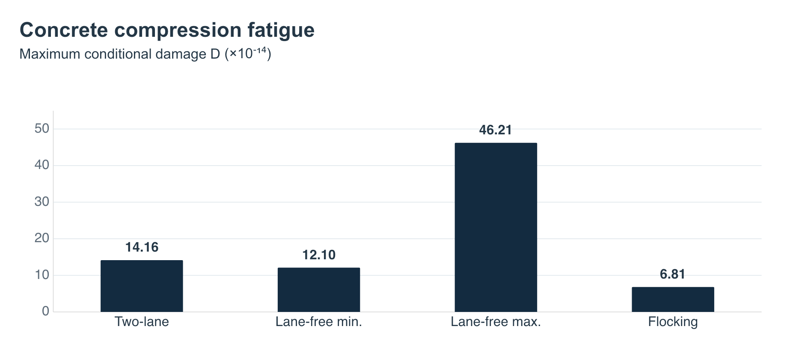
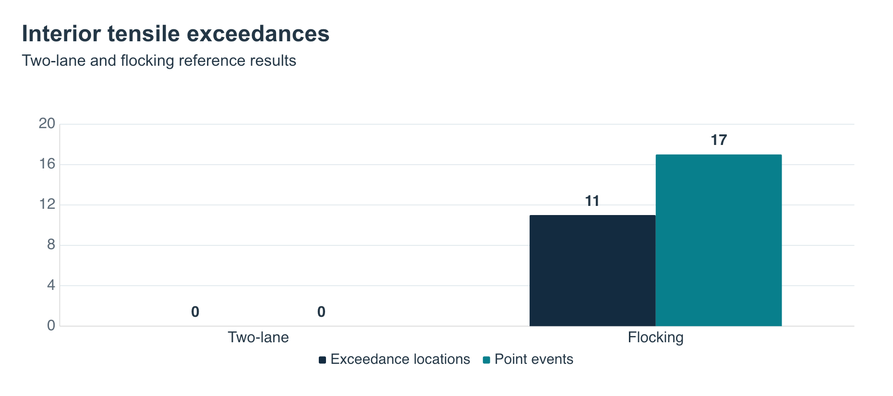

# Concrete Bridge Deck and Slab Fatigue under Lane-Free Traffic

Assessment Using a Vehicle–Bridge Interaction Framework

**Wang Yanjun**  
Civil, Environmental and Resources Engineering, Faculty of Engineering, Kyoto University

[Research poster (PDF)](poster/VBI_research_poster.pdf) · [Editable PowerPoint](poster/VBI_research_poster.pptx) · [Results](docs/results.md) · [My contribution](CONTRIBUTION.md)

## Fatigue results

All **22 traffic scenarios** in the 29–30 October 2026 simulation campaign completed. Maximum conditional compression damage was **1.24296 × 10⁻¹³** for the two-lane reference and **6.1632 × 10⁻¹⁴** for flocking. Flocking had **10 tensile exceedance locations and 16 point events**. The two-lane reference had zero.

## Peak stress coverage

Across the 22 scenarios, the interior sampled-to-plate-centre peak ratios were **99.86–104.45% in tension** and **99.71–102.05% in compression**. These percentages compare principal stress peak amplitudes.

## Contribution and acknowledgement

My contribution covers model reconstruction, numerical verification, simulation review and the concrete fatigue assessment. Professor Kai-Chun Chang provided the bridge drawings and source reference materials. [Contribution statement](CONTRIBUTION.md)
