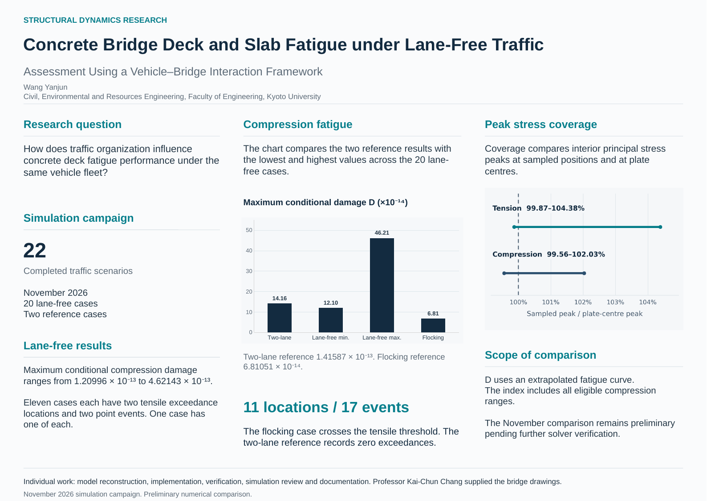
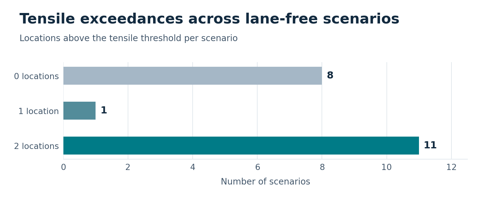
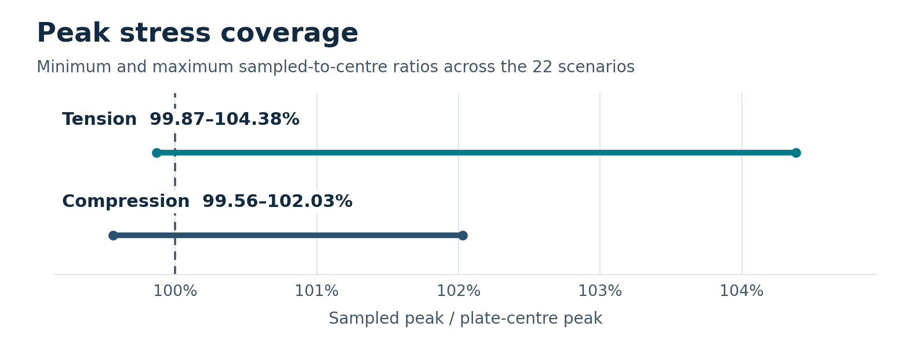

# Concrete Bridge Deck and Slab Fatigue under Lane-Free Traffic

Assessment Using a Vehicle–Bridge Interaction Framework

**Wang Yanjun**  
Civil, Environmental and Resources Engineering, Faculty of Engineering, Kyoto University

[Research poster (PDF)](poster/VBI_research_poster.pdf) · [Editable PowerPoint](poster/VBI_research_poster.pptx) · [Results](docs/results.md) · [My contribution](CONTRIBUTION.md)

## Fatigue results

The November 2026 simulation campaign completed **22 traffic scenarios**. Maximum conditional compression damage was **1.41587 × 10⁻¹³** for the two-lane reference and **6.81051 × 10⁻¹⁴** for flocking. Flocking had **11 tensile exceedance locations and 17 point events**. The two-lane reference had zero.

The compression index uses an extrapolated S–N curve. The November comparison remains preliminary pending further solver verification.

## Tensile exceedances across lane-free scenarios

Of the 20 lane-free scenarios, eight had no tensile exceedance locations, one had one location, and eleven had two.

## Peak stress coverage

Across the 22 scenarios, the interior sampled-to-plate-centre peak ratios were **99.87–104.38% in tension** and **99.56–102.03% in compression**. These percentages compare principal stress peak amplitudes. The dashed line marks equal peak amplitudes. Values above 100% occur when the sampled peak is higher than the peak at the plate centres.

## Contribution and acknowledgement

My contribution covers model reconstruction, numerical verification, simulation review and the concrete fatigue assessment. Professor Kai-Chun Chang provided the bridge drawings and source reference materials. [Contribution statement](CONTRIBUTION.md)
