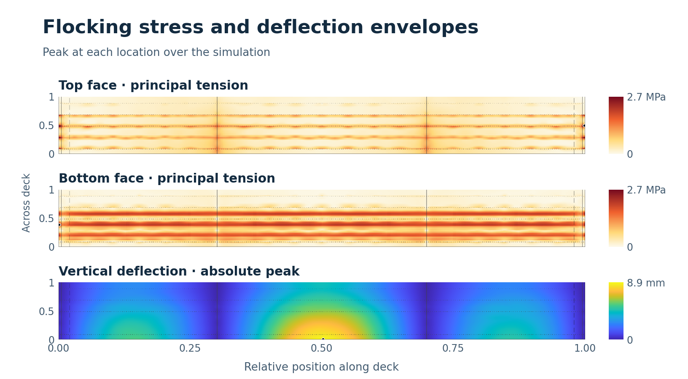

# Concrete Bridge Deck and Slab Fatigue under Lane-Free Traffic

Assessment Using a Vehicle–Bridge Interaction Framework

**Wang Yanjun**  
Civil, Environmental and Resources Engineering, Faculty of Engineering, Kyoto University

[Research poster (PDF)](poster/VBI_research_poster.pdf) · [Editable PowerPoint](poster/VBI_research_poster.pptx) · [Results](docs/results.md) · [My contribution](CONTRIBUTION.md)

## Research question and approach

How does the way vehicles travel across a bridge change where concrete deck stresses build up? I compared 22 vehicle–bridge simulations with the same fleet, including two-lane and flocking references. I used elastic response envelopes to locate peaks, then assessed recovered concrete stresses for tensile exceedances and repeated compression.

## Where stress and deflection concentrate

In the flocking reference, top-face tension follows the girder lines, while bottom-face tension concentrates between them. This pattern is consistent with bending over the girders and local sagging between them. The largest vertical deflection occurs near the middle of the bridge. The three panels show the time peak at each location from the elastic model.

## Where the tensile threshold is exceeded

The two-lane reference had **zero exceedances**. Flocking had **11 locations and 17 point events**, concentrated in a narrow band across the deck. Colours show recovered tensile stress relative to the local screening strength. Red rings mark exceedance. Nearby observations are combined on a relative grid for display, and labels show where a ring represents multiple flagged locations.

Flocking produced **8.82 mm** peak deflection versus **5.50 mm** for two-lane traffic, with similar peak interior accelerations. The [detailed results](docs/results.md) give the response comparison, compression check, and peak coverage. The November results remain preliminary pending further solver verification.

## Contribution and acknowledgement

My contribution covers model reconstruction, numerical verification, simulation review and the concrete fatigue assessment. Professor Kai-Chun Chang provided the bridge drawings and source reference materials. [Contribution statement](CONTRIBUTION.md)
