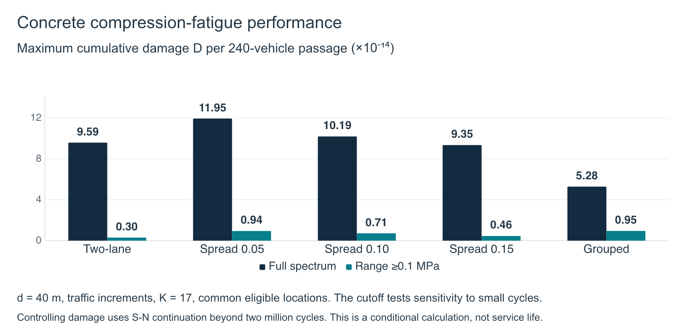
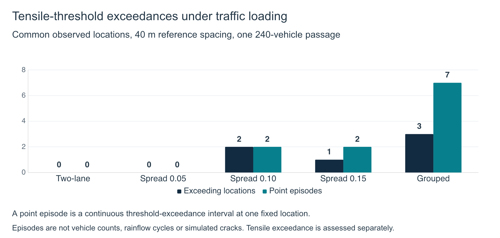

# Concrete Deck Fatigue Performance

Wang Yanjun. October 2026.

## Computational study

The equivalent bridge model includes 26,520 MITC4 Reissner–Mindlin bending/shear plate elements, coupled steel beams and supports, and approximately 79,600 algebraic coordinates. All 22 selected scenarios use the same 240-vehicle fleet, including 20 heavy vehicles, at 10 m/s on a smooth road. The time step is 0.002 s.

The scenarios vary vehicle-reference spacing, normalized lateral spread and heavy-vehicle ordering, with two-lane and grouped-traffic references. Only the 40 m cases have matched passage durations relative to the two-lane reference. Other spacings compare the same fleet over different passage durations. Grouped traffic changes the overall traffic organization.

## Fatigue calculation

Drawing-based nominal reinforcement sections recover the concrete surface stress tensor from the saved plate-moment histories. The sections assume uncracked concrete, perfect bond and zero local membrane resultant. The dynamic solution remains the source of the section resultants.

Compression fatigue uses a common set of 57 interior locations that remain below the tensile threshold in all 22 cases. At each fixed location, face and normal direction, the compression history is c(t) = max(−sigma(t), 0). Rainflow counting retains full and half cycles. The adopted compression S-N relationship and cumulative damage are:

$$
\log_{10}N_i=K\left[1-\frac{\Delta\sigma_{c,i}}{0.85(f_d-\sigma_p)}\right],
\qquad
D=\sum_i\frac{n_i}{N_i}.
$$

Here nᵢ is the counted number of cycles and Nᵢ is the number of cycles given by the adopted S-N relationship at that stress range. The displayed branch uses **K = 17**, **f_d = 24/1.3 MPa**, **sigma_p = 0**, and traffic-load stress increments. Each case reports the maximum D across the same eligible locations, faces and directions. Directions are evaluated separately rather than summed.

The full spectrum retains every nonzero rainflow range. Additional calculations retain only ranges at least 0.1 or 0.5 MPa to test sensitivity to small cycles. These cutoffs are postprocessing assumptions, not material fatigue limits. Every displayed controlling damage sum uses the S-N relationship beyond two million cycles. Its numerical continuation supports a conditional comparison, not a verified service-life prediction.

## Compression-fatigue performance

For the duration-matched 40 m cases, full-spectrum maximum D is 9.593 × 10⁻¹⁴ for two-lane traffic and 5.282 × 10⁻¹⁴ for grouped traffic. Retaining ranges of at least 0.1 MPa gives 2.978 × 10⁻¹⁵ and 9.546 × 10⁻¹⁵, respectively. The difference changes direction under the cutoff sensitivity, so the compression calculation does not support a unique overall ordering independent of the cycle-treatment assumption.

These values describe damage accumulated during one simulated 240-vehicle passage. The study does not assume annual traffic growth or convert D into years of service.

## Tensile-threshold exceedances

Tensile assessment uses the full synchronous surface stress tensor at 61 common interior locations. A continuous interval above the adopted local tensile threshold counts as one point episode. A vehicle can contribute episodes at more than one location, so an episode is neither a vehicle count nor a rainflow cycle.

At 40 m reference spacing, grouped traffic has **3 exceeding locations and 7 point episodes**. Two-lane traffic and the uniform-order spread-0.05 case have no exceedances in the common observed set. Exceedance indicates a tensile-threshold candidate under the model assumptions. It does not simulate physical crack development.

Locations with tensile exceedance do not enter the common compression-fatigue pool. Lower compression damage in the remaining eligible pool cannot offset tensile exceedance elsewhere.

## Results for all 22 scenarios

The scenario label gives reference spacing / normalized lateral spread / heavy-vehicle ordering. All D values use K = 17 and traffic-load increments. The tensile columns use the common tensile-assessment locations. Damage maxima may control at different locations between cases or cutoff assumptions.

| Scenario | D, full spectrum | D, range ≥0.1 MPa | D, range ≥0.5 MPa | Exceeding locations | Point episodes |
|---|---:|---:|---:|---:|---:|
| 30 m / 0.05 / Uniform | 8.480e-14 | 9.330e-15 | 6.693e-15 | 0 | 0 |
| 30 m / 0.10 / Clustered | 7.582e-14 | 6.971e-15 | 4.554e-15 | 2 | 2 |
| 30 m / 0.10 / Fixed random | 7.584e-14 | 7.036e-15 | 4.620e-15 | 2 | 2 |
| 30 m / 0.10 / Uniform | 7.583e-14 | 7.043e-15 | 4.625e-15 | 2 | 2 |
| 30 m / 0.15 / Uniform | 6.846e-14 | 4.555e-15 | 3.308e-15 | 1 | 2 |
| 40 m / 0.05 / Uniform | 1.195e-13 | 9.410e-15 | 6.775e-15 | 0 | 0 |
| 40 m / 0.10 / Clustered | 1.025e-13 | 7.087e-15 | 4.635e-15 | 2 | 2 |
| 40 m / 0.10 / Fixed random | 1.023e-13 | 7.113e-15 | 4.661e-15 | 2 | 2 |
| 40 m / 0.10 / Uniform | 1.019e-13 | 7.115e-15 | 4.662e-15 | 2 | 2 |
| 40 m / 0.15 / Uniform | 9.351e-14 | 4.591e-15 | 3.325e-15 | 1 | 2 |
| 60 m / 0.05 / Uniform | 1.633e-13 | 9.470e-15 | 6.813e-15 | 0 | 0 |
| 60 m / 0.10 / Clustered | 1.559e-13 | 7.150e-15 | 4.691e-15 | 2 | 2 |
| 60 m / 0.10 / Fixed random | 1.547e-13 | 7.140e-15 | 4.681e-15 | 2 | 2 |
| 60 m / 0.10 / Uniform | 1.530e-13 | 7.144e-15 | 4.685e-15 | 2 | 2 |
| 60 m / 0.15 / Uniform | 1.379e-13 | 4.631e-15 | 3.335e-15 | 1 | 2 |
| 115 m / 0.05 / Uniform | 2.940e-13 | 9.466e-15 | 6.809e-15 | 0 | 0 |
| 115 m / 0.10 / Clustered | 2.643e-13 | 7.138e-15 | 4.679e-15 | 2 | 2 |
| 115 m / 0.10 / Fixed random | 2.626e-13 | 7.139e-15 | 4.680e-15 | 2 | 2 |
| 115 m / 0.10 / Uniform | 2.626e-13 | 7.139e-15 | 4.680e-15 | 2 | 2 |
| 115 m / 0.15 / Uniform | 2.506e-13 | 4.632e-15 | 3.337e-15 | 1 | 2 |
| Grouped traffic | 5.282e-14 | 9.546e-15 | 8.417e-15 | 3 | 7 |
| Two-lane reference | 9.593e-14 | 2.978e-15 | 6.023e-16 | 0 | 0 |

## Coverage and verification

Nominal reinforcement-section recovery covers all saved observation coordinates. Recorded stress ranges reach at least **98.53%** of the corresponding interior full-field range upper bound across the 22 cases. That bound propagates saved moment-component envelopes through the section-recovery operator. It is not an exact synchronous field range, a missing full-field history, or a measure of whole-deck cumulative-damage convergence.

The implementation passes 3,808 independent section-resultant integrations and 23,680 cycle/parameter recomputations. The largest relative error in recomputing the saved damage is approximately 8.6 × 10⁻¹⁵. These checks verify the calculation under the adopted assumptions.

## Acknowledgement and scope

Professor Kai-Chun Chang provided the bridge drawings and source reference materials. This public case study contains aggregate results and explanatory figures. The private framework, source drawings, model files and raw simulation histories remain excluded. The adopted exposure coefficient, permanent-stress baseline, S-N continuation and small-cycle treatment limit the interpretation. Experimental validation and actual fatigue life remain open.
