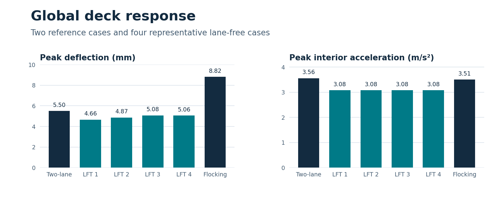
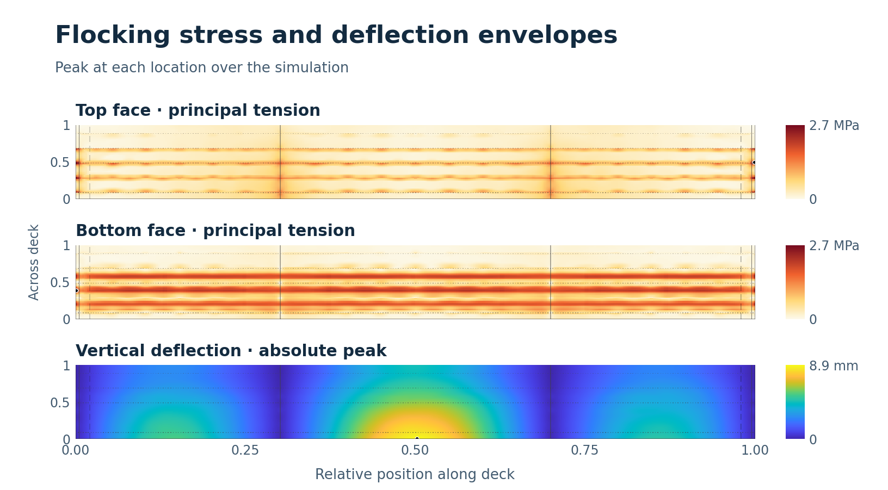
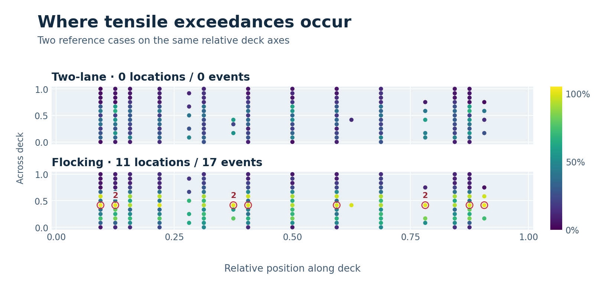

# Concrete Deck Response and Fatigue Results

Wang Yanjun. November 2026 simulation campaign, 22 completed traffic scenarios.

## Research question and approach

How does the way vehicles travel across a bridge change where concrete deck stresses build up? I compared 22 vehicle–bridge simulations with the same fleet, including two-lane and flocking references. I used elastic response envelopes to locate peaks, then assessed recovered concrete stresses for tensile exceedances and repeated compression.

## Global response

The same-fleet comparison shows 8.82 mm peak deflection for flocking and 5.50 mm for the two-lane reference. Their peak interior accelerations were 3.51 and 3.56 m/s², respectively. The maxima can occur at different locations and times.

LFT 1–4 are four representative lane-free cases ordered by increasing longitudinal vehicle spacing.

## Where stress and deflection concentrate

In the flocking reference, top-face tension follows the girder lines, while bottom-face tension concentrates between them. This pattern is consistent with bending over the girders and local sagging between them. The largest vertical deflection occurs near the middle of the bridge. The three panels show the time peak at each location from the elastic model.

These elastic-model envelopes and the recovered concrete stresses used in the tensile check are separate quantities. Deck positions in the public figures are dimensionless.

## Where the tensile threshold is exceeded

The two-lane reference had **zero exceedances**. Flocking had **11 locations and 17 point events**, concentrated in a narrow band across the deck. Colours show recovered tensile stress relative to the local screening strength. Red rings mark exceedance. Nearby observations are combined on a relative grid for display, and labels show where a ring represents multiple flagged locations.

| Reference | Peak principal tension | Peak tensile utilization | Locations | Point events |
|---|---:|---:|---:|---:|
| Two-lane | 1.267 MPa | 66.19% | 0 | 0 |
| Flocking | 1.983 MPa | 103.64% | 11 | 17 |

A point event is a continuous interval above the local tensile threshold at one observation point.

## Compression check

The highest principal compression utilization was **13.53%** of design compressive strength across the 22 scenarios. The largest eligible compression cycle range was **2.463 MPa** for flocking and **1.728 MPa** for two-lane traffic. Across the 20 lane-free cases it ranged from **2.144 to 2.334 MPa**.

The conditional fatigue comparison retains all eligible compression cycles under an extrapolated S–N curve. Very small stress ranges dominate those sums at the controlling locations. The November results remain preliminary pending further solver verification.

[Conditional compression fatigue comparison](../assets/fatigue_performance.png)

## Peak stress coverage

| Interior principal stress peak coverage | Range across 22 scenarios |
|---|---:|
| Tension | 99.87–104.38% |
| Compression | 99.56–102.03% |

Peak coverage is the sampled peak divided by the plate-centre peak. The dashed line marks equal peak amplitudes. Values above 100% occur when the sampled peak is higher than the peak at the plate centres.

