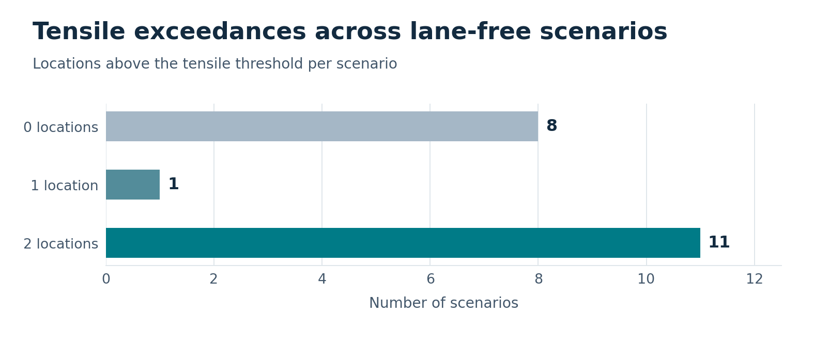
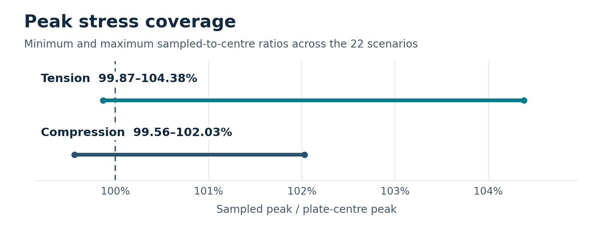

# Concrete Deck Fatigue Results

Wang Yanjun. November 2026 simulation campaign. All 22 scenarios completed.

| Traffic case | Maximum conditional compression damage D | Tensile exceedance locations | Tensile point events |
|---|---:|---:|---:|
| Two-lane reference | 1.41587 × 10⁻¹³ | 0 | 0 |
| Flocking reference | 6.81051 × 10⁻¹⁴ | 11 | 17 |

Across the 20 lane-free cases, maximum conditional compression damage ranges from **1.20996 × 10⁻¹³ to 4.62143 × 10⁻¹³**. Eleven cases each have two tensile exceedance locations and two point events. One case has one location and one event. The remaining eight cases had no exceedances.

The compression index uses an extrapolated S–N curve. The November comparison remains preliminary pending further solver verification.

| Interior principal stress peak coverage | Range across 22 scenarios |
|---|---:|
| Tension | 99.87–104.38% |
| Compression | 99.56–102.03% |

Peak coverage is the sampled peak divided by the plate-centre peak. The dashed line marks equal peak amplitudes. Values above 100% occur when the sampled peak is higher than the peak at the plate centres.

