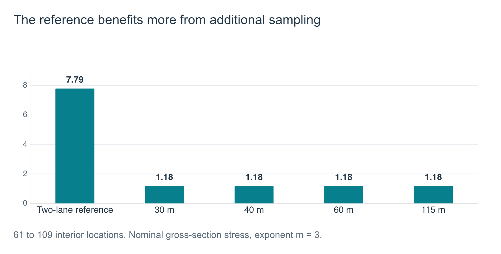

# Selected Results

Wang Yanjun. Research snapshot assembled 27 October 2026.

## Study scope

The computational study uses an equivalent bridge model with 26,520 MITC4 Reissner–Mindlin bending/shear plate elements and coupled steel beams and supports. The model has approximately 79,600 algebraic coordinates. The 22 selected traffic scenarios retain the same fleet of 240 vehicles, including 20 heavy vehicles. They explore vehicle-reference spacing, normalized lateral spread and vehicle ordering, together with two-lane and grouped-traffic references. This is a selected scenario study, not a full factorial design or a statistical ensemble.

Twenty initial scenarios passed saved-result completeness and contact-convergence checks. The five additional-output reruns described below preserved the original 213 scalar moment histories exactly. These checks support data consistency and solver convergence for the audited runs. They do not establish local spatial/time-step convergence or experimental validity for every reported quantity.

## Spatial sampling sensitivity

The original map contains 71 physical observation locations, of which 61 lie at least 2 m from the bridge ends. The expanded map contains 119 locations, including 109 interior locations. Each location supplies three signed moment components. The comparison here uses the longitudinal/transverse normal-stress components at interior locations.

Five cases share the expanded map: one two-lane reference and four uniform-order cases at normalized lateral spread 0.05 and vehicle-reference spacings of 30, 40, 60 and 115 m. Additional-output reruns use the same dynamic inputs. Every original moment channel matches its previous complete history with zero difference.

The historical gross-section recovery uses nominal uncracked concrete bending stress, sigma = 6M/t², with local thickness evaluated at each probe. It excludes a permanent-load/membrane baseline. Rainflow counting uses each fixed scalar component's complete signed history with half-cycle weights. The screening index is:

\[
I_{m,j}=\sum_i n_i\left(\frac{\Delta\sigma_{i,j}}{1\ \mathrm{MPa}}\right)^m,
\qquad
R_{m,\max}=\frac{\max_j I_{m,j}(\mathrm{case})}{\max_j I_{m,j}(\mathrm{reference})}.
\]

The exponents m = 3 and 5 are declared screening weights. They do not represent an adopted material S-N relation. Each map supplies both the numerator and denominator of its own ratio. The controlling locations may differ between cases.

| Vehicle reference spacing | Original-map R₃ | Expanded-map R₃ | Original-map R₅ | Expanded-map R₅ |
|---|---:|---:|---:|---:|
| 30 m | 11.6144 | 1.7622 | 39.5816 | 2.6186 |
| 40 m | 11.8065 | 1.7905 | 40.4374 | 2.6668 |
| 60 m | 11.7760 | 1.7864 | 40.2933 | 2.6566 |
| 115 m | 11.7615 | 1.7846 | 40.2322 | 2.6552 |

The expanded map increases the reference's maximum I₃ by a factor of 7.7912, compared with approximately 1.182 for the four comparison cases. This explains why the relative index decreases without a change in the original histories.

The 40 m cases provide the duration-matched reference comparison. Other spacings compare the response to the same 240 vehicles over different passage durations. They do not represent equal-density comparisons or hourly/annual fatigue rates. The expanded map improves the evidence but does not certify a whole-deck cumulative-index maximum.

## Subsequent section-recovery work

The 26 October extension assigns drawing-derived, smeared nominal reinforcement sections to all 119 saved coordinates. It checks 952 section variants through 3,808 independent unit-resultant integrations, with a maximum normalized residual of approximately 1.1 × 10⁻¹⁴. These checks verify implementation under the stated assumptions.

This extension recovers stresses from the saved section-resultant histories while retaining the original dynamic solution. It does not reassemble the global bridge with the new section stiffness, resolve actual cracking, or establish as-built reinforcement geometry. It remains separate from the historical gross-section sampling result above. This case study does not publish an absolute material-damage or fatigue-life estimate.

## Evidence dates and limitations

| Evidence | Research record date | Supported conclusion |
|---|---|---|
| Initial campaign saved-result audit | 16 October 2026 | Complete, finite histories and declared contact convergence for the 20 audited cases |
| Common expanded-map comparison | 23 October 2026 | Exact regression of original histories and the five-case sampling comparison |
| Section-mapping verification | 26 October 2026 | Numerical section-recovery implementation under nominal mapping assumptions |

The private research workspace retains the underlying reports, source results and numerical checks. This public account contains selected aggregate values and newly written explanations. Independent rerunning of the full simulation requires the private implementation and inputs. Experimental validation, local convergence of fatigue quantities and a suitable material fatigue law remain open.
