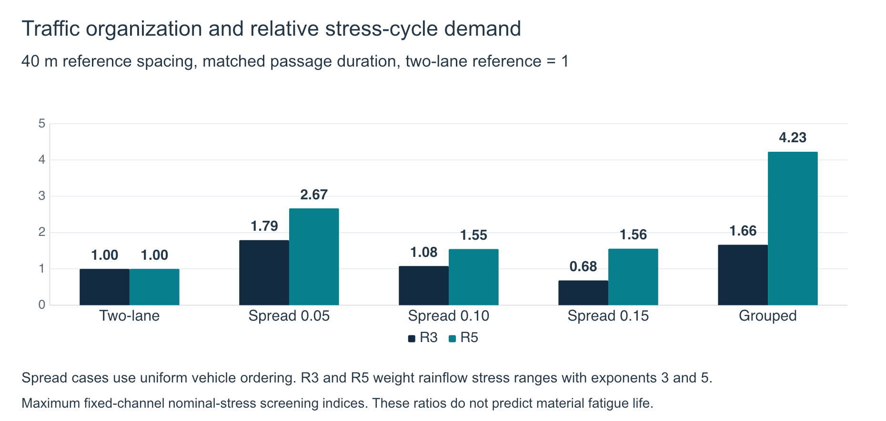
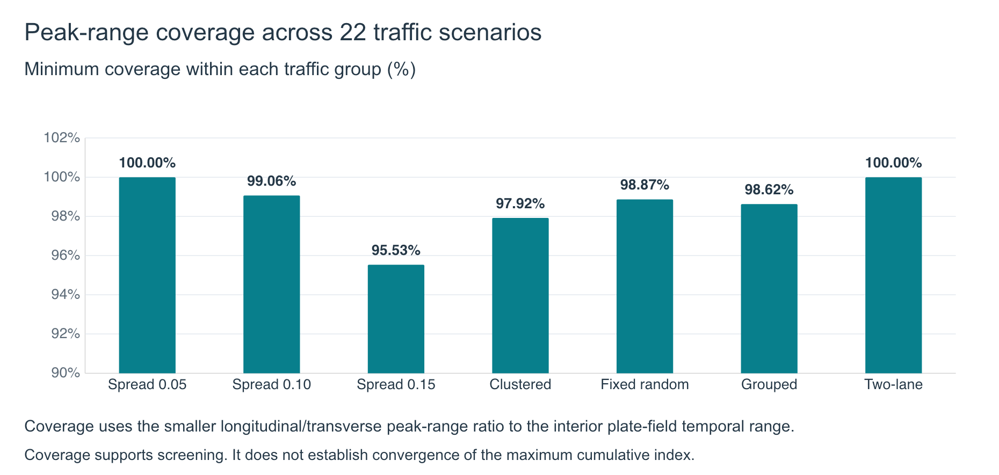

# Results

Wang Yanjun. October 2026.

## Computational study

The equivalent bridge model includes 26,520 MITC4 Reissner–Mindlin bending/shear plate elements, coupled steel beams and supports, and approximately 79,600 algebraic coordinates. All 22 selected scenarios use the same 240-vehicle fleet, including 20 heavy vehicles, at 10 m/s on a smooth road. The time step is 0.002 s.

The selected scenarios vary vehicle-reference spacing, normalized lateral spread and heavy-vehicle ordering, with two-lane and grouped-traffic references. This is a selected scenario study, rather than a full factorial design or a statistical ensemble. Grouped traffic changes the overall organization of the fleet and does not isolate a single causal variable.

## Stress-cycle indices

Nominal uncracked gross-section concrete bending stress follows sigma = 6M/t², using the local thickness at each fixed probe. The stress increments exclude a permanent-load/membrane baseline. Complete signed histories provide rainflow stress ranges, with half-cycle weights. Longitudinal and transverse normal components enter the screening separately.

$$
I_{m,j}=\sum_i n_i\left(\frac{\Delta\sigma_{i,j}}{1\ \mathrm{MPa}}\right)^m,
\qquad
R_{m,\max}=\frac{\max_j I_{m,j}(\mathrm{case})}{\max_j I_{m,j}(\mathrm{reference})}.
$$

The two-lane reference equals 1. Exponents m = 3 and 5 are declared screening weights. They do not represent adopted material S-N slopes. The maxima in the numerator and denominator may occur at different fixed locations.

## Traffic comparison

At the duration-matched 40 m reference spacing, uniform traffic with lateral spread 0.15 has R₃ = 0.6792 and R₅ = 1.5565. Grouped traffic has R₃ = 1.6645 and R₅ = 4.2287. Consequently, a lower exponent-3 index does not establish a lower index when large cycles receive exponent-5 weighting.

Across uniform-order cases at all four reference spacings, lateral spread 0.05 gives R₃ = 1.7622–1.7905 and R₅ = 2.6186–2.6668. Lateral spread 0.15 gives R₃ = 0.6718–0.6792 and R₅ = 1.5321–1.5565.

## Peak-range coverage

Coverage compares the largest saved rainflow range with the interior plate-field temporal range in each normal direction. The reported case coverage is the smaller longitudinal/transverse ratio. The minimum across all 22 cases is **95.53%**.

Coverage measures capture of peak stress range. It supports the scenario screening objective, while cumulative-index convergence and certified whole-deck fatigue maxima remain separate questions.

## Complete scenario results

The scenario label gives reference spacing / normalized lateral spread / heavy-vehicle ordering. Ratios use the same two-lane reference for all cases.

| Scenario | R₃ | R₅ | Minimum peak-range coverage |
|---|---:|---:|---:|
| 30 m / 0.05 / Uniform | 1.7622 | 2.6186 | 100.00% |
| 30 m / 0.10 / Clustered | 1.0387 | 1.4543 | 97.92% |
| 30 m / 0.10 / Fixed random | 1.0565 | 1.5185 | 98.87% |
| 30 m / 0.10 / Uniform | 1.0584 | 1.5453 | 99.14% |
| 30 m / 0.15 / Uniform | 0.6718 | 1.5358 | 95.53% |
| 40 m / 0.05 / Uniform | 1.7905 | 2.6668 | 100.00% |
| 40 m / 0.10 / Clustered | 1.0990 | 1.4845 | 98.93% |
| 40 m / 0.10 / Fixed random | 1.0819 | 1.5138 | 98.88% |
| 40 m / 0.10 / Uniform | 1.0775 | 1.5468 | 99.06% |
| 40 m / 0.15 / Uniform | 0.6792 | 1.5565 | 96.71% |
| 60 m / 0.05 / Uniform | 1.7864 | 2.6566 | 100.00% |
| 60 m / 0.10 / Clustered | 1.0704 | 1.4797 | 99.20% |
| 60 m / 0.10 / Fixed random | 1.0692 | 1.5099 | 99.16% |
| 60 m / 0.10 / Uniform | 1.0684 | 1.5450 | 99.17% |
| 60 m / 0.15 / Uniform | 0.6737 | 1.5369 | 98.10% |
| 115 m / 0.05 / Uniform | 1.7846 | 2.6552 | 100.00% |
| 115 m / 0.10 / Clustered | 1.0662 | 1.4740 | 99.16% |
| 115 m / 0.10 / Fixed random | 1.0676 | 1.5111 | 99.17% |
| 115 m / 0.10 / Uniform | 1.0672 | 1.5441 | 99.17% |
| 115 m / 0.15 / Uniform | 0.6723 | 1.5321 | 98.10% |
| Grouped traffic | 1.6645 | 4.2287 | 98.62% |
| Two-lane reference | 1.0000 | 1.0000 | 100.00% |

Only the 40 m cases provide a duration-matched comparison to the two-lane reference. Other spacings compare the same 240 vehicles over different passage durations. These are not hourly or annual fatigue-rate ratios.

## Section recovery and numerical checks

Nominal reinforcement-section recovery covers all saved observation coordinates. The implementation checks 952 section variants using 3,808 independent unit-resultant integrations, with a maximum normalized residual of approximately 1.1 × 10⁻¹⁴. The checks verify the implementation under the stated nominal section assumptions.

Section recovery retains the saved dynamic section-resultant histories. It does not reassemble the global bridge with the recovered section stiffness or resolve physical cracking. Its verification does not turn the nominal stress-cycle indices above into a calibrated material-damage or fatigue-life estimate.

## Acknowledgement and scope

Professor Kai-Chun Chang provided the bridge drawings and source reference materials. This public case study contains aggregate results and explanatory figures. The private framework, source drawings, model files and raw simulation histories remain excluded. Experimental validation and a suitable material fatigue law remain open.
