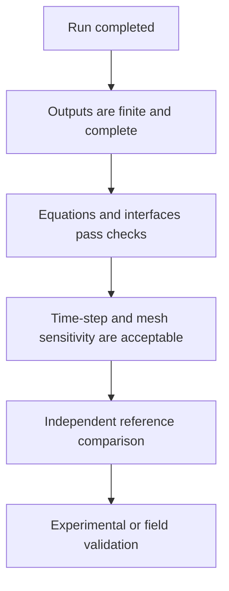

# Validation and Evidence

## Evidence hierarchy

Passing one level does not automatically satisfy the next.

## Examples of verification logic

### Matrix-level checks

- symmetry of mass and stiffness matrices;
- positive-definiteness or a documented explanation of constrained modes;
- eigen-equation residuals;
- static equilibrium and load-resultant balance.

### Contact-interface checks

- force partition over the contact region;
- exactness for simple displacement fields;
- consistency between displacement and velocity mappings;
- a virtual-work check between vehicle contact forces and bridge nodal forces.

### Transient checks

- finite response histories;
- bounded nonlinear or coupling iterations;
- unchanged tolerances across comparison cases;
- full vehicle passage and sufficient post-passage response;
- explicit comparison across time-step and mesh refinements.

## Why the wording matters

Several statements may sound similar but carry different scientific meaning:

| Statement | What it supports |
|---|---|
| A simulation finished | The program reached its end condition. |
| The residual is small | The numerical equations were solved to the declared tolerance. |
| A refined run is close | The selected output is insensitive within the tested range. |
| Selected frequencies match | The model reproduces those frequencies, possibly by calibration. |
| The model is physically validated | Independent real or experimental evidence supports the intended use. |

The case study emphasizes this distinction because responsible research software should communicate not only results, but also the strength of the evidence behind them.

