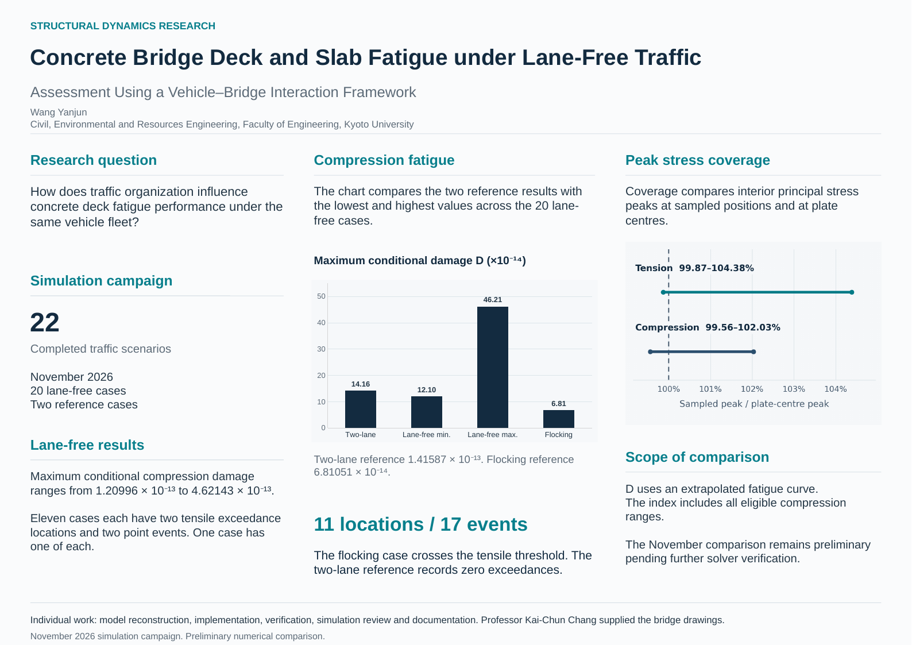

# Research Poster

**Concrete Bridge Deck and Slab Fatigue under Lane-Free Traffic**

Assessment Using a Vehicle–Bridge Interaction Framework

Wang Yanjun, Kyoto University

- [PDF, A3 landscape](VBI_research_poster.pdf)
- [Editable PowerPoint](VBI_research_poster.pptx)
- [Abstract](../docs/poster-abstract.md)
- [Fatigue results and peak stress coverage](../docs/results.md)

