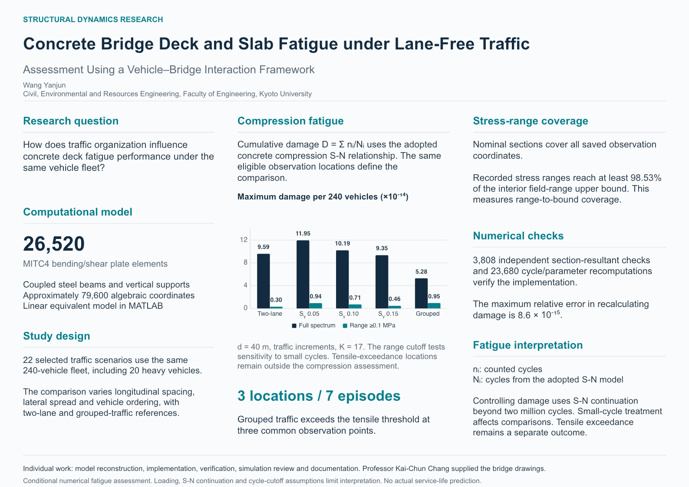

# Research Poster

**Concrete Bridge Deck and Slab Fatigue under Lane-Free Traffic**

Assessment Using a Vehicle–Bridge Interaction Framework

Wang Yanjun, Kyoto University

- [PDF reading copy](VBI_research_poster.pdf)
- [Editable PowerPoint](VBI_research_poster.pptx)
- [Abstract and suggested citation](../docs/poster-abstract.md)
- [Numerical definitions and results](../docs/results.md)

The poster uses a single A3 landscape page (420 × 297 mm) for online reading. Its text and data chart remain editable in PowerPoint. The PDF can scale proportionally for larger printing.

The poster presents calculated compression-fatigue damage, tensile-threshold exceedances and coverage of the recovered stress ranges. Professor Kai-Chun Chang provided the bridge drawings and source references. The results retain the adopted loading, S-N and cycle-cutoff assumptions and do not predict actual service life.
